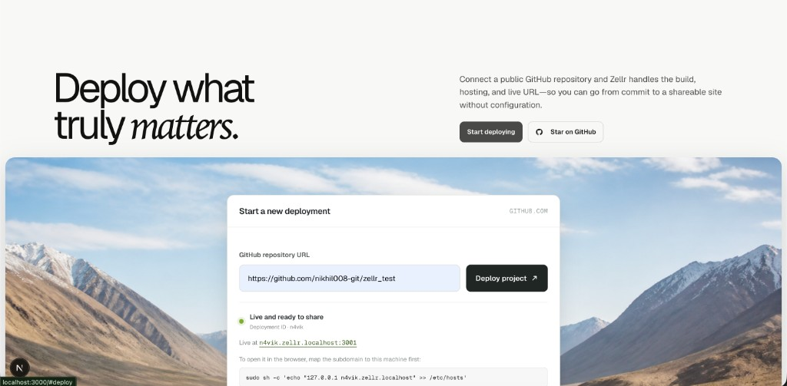
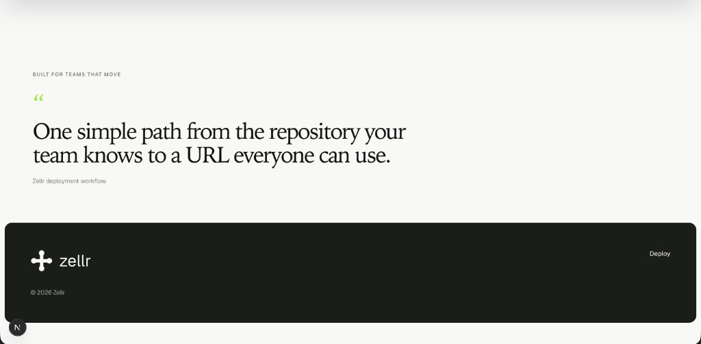
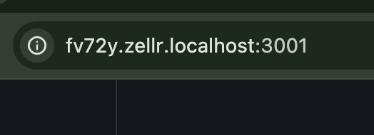

<div align="center">

# Zellr

**Paste a GitHub URL → get a live static site on its own subdomain.**

`http://{id}.zellr.localhost:3001`


</div>





A public GitHub repo, built and served on its own subdomain:




---

## What is Zellr?

Zellr is a small Vercel-style static deploy platform. You submit a public GitHub repo; Zellr clones it, builds it (`npm install && npm run build`), stores the output in Cloudflare R2, and serves it on a unique subdomain.

The live product hostnames:

| Hostname | Service |
|----------|---------|
| `localhost:3000` | Dashboard (Next.js web) |
| `localhost:4000` | Upload API |
| `{id}.zellr.localhost:3001` | Deployed site (request-handler) |

Example: after a deploy with id `6g3xo`, the site is at:

```
http://6g3xo.zellr.localhost:3001/
```

Locally (bypassing nginx) the same site is:

```
http://6g3xo.zellr.localhost:3001/
```

or `http://localhost:3001/` with `Host: 6g3xo.zellr.localhost`.

---

## How it works

```
 GitHub URL
     │
     ▼
 ┌─────────────┐   POST /upload     ┌──────────────────┐
 │  Web (:3000)│ ─────────────────▶ │ Upload service   │
 └─────────────┘                    │ (api :4000)      │
                                    └────────┬─────────┘
                                             │
                    1. generate 5-char id (e.g. 6g3xo)
                    2. git clone → upload source to R2
                       key prefix: output/{id}/
                    3. Redis LPUSH build-queue
                       HSET status {id} = uploaded
                                             │
                                             ▼
                                    ┌──────────────────┐
                                    │ Deploy service   │
                                    │ (background)     │
                                    └────────┬─────────┘
                                             │
                    4. BRPOP build-queue
                    5. download output/{id}/
                    6. npm install && npm run build
                    7. upload dist/ → R2 dist/{id}/
                    8. HSET status {id} = deployed
                                             │
                                             ▼
 ┌──────────────────┐   Host: 6g3xo.…     ┌──────────────────┐
 │ Browser request  │ ──────────────────▶ │ Request handler  │
 │ to subdomain     │                     │ (:3001)          │
 └──────────────────┘                     └────────┬─────────┘
                                                   │
                    id = hostname.split(".")[0]  →  6g3xo
                    GET R2 object dist/6g3xo/index.html
                    (or dist/6g3xo{path} for assets)
```

### Status lifecycle

| Redis `status` field | Meaning |
|----------------------|---------|
| *(missing)* | Unknown id |
| `uploaded` | Source in R2, waiting for / in build |
| `deployed` | Built assets in `dist/{id}/`, ready to serve |

The landing page polls `GET /status?id={id}` every 2s until status is `deployed`, then shows `http://{id}.{NEXT_PUBLIC_SITE_DOMAIN}:3001`.

### How a subdomain request is resolved

For `http://6g3xo.zellr.localhost:3001/`:

1. **Local hostname / nginx** — `*.zellr.localhost` resolves to this machine; nginx matches the wildcard and proxies to `127.0.0.1:3001` (request-handler). Hitting `:3001` directly skips nginx but uses the same handler.
2. **ID extraction** — `req.hostname` is `6g3xo.zellr.localhost` → first label → `6g3xo`.
3. **Path** — `/` becomes `/index.html`.
4. **R2 fetch** — object key `dist/6g3xo/index.html`.
5. **MIME** — `.html` / `.css` / `.js` mapped; everything else `application/octet-stream`.

Assets like `/assets/index-abc.js` resolve to `dist/6g3xo/assets/index-abc.js`.

**Build assumption:** the repo must produce a `dist/` folder (Vite / CRA-style). That folder is what gets uploaded and served.

---

## Architecture

```
apps/
├── web/               # Next.js landing — submit repo, poll status
├── upload-service/    # Express API — clone, upload source, enqueue
├── deploy-service/    # Worker — build + upload dist
├── request-handler/   # Express — subdomain → R2 static files
```

Shared plumbing: **Redis** (`build-queue` list + `status` hash) and **Cloudflare R2** (S3-compatible).

---

## Deployment roadmap

The full plan for framework detection, static and dynamic build paths, R2, Docker/ECR/Lambda/ECS/Render options, Cloudflare wildcard DNS/TLS, reverse proxying, and GitHub Actions is in [DEPLOYMENT_RUNBOOK.md](./DEPLOYMENT_RUNBOOK.md).

### Remaining work

- [ ] Add a Postgres deployment registry and release state machine.
- [ ] Implement framework presets, overrides, and fixture tests.
- [ ] Move builds to an isolated runner.
- [ ] Make R2 releases atomic, streamed, MIME-correct, and rollbackable.
- [ ] Add dynamic Docker image build/push, health checks, and secret injection.
- [ ] Replace first-label-only serving with registry-backed static/dynamic routing.
- [ ] Deploy the control plane to Render and complete Cloudflare domain verification.
- [ ] Add GitHub Actions CI plus one deploy trigger.
- [ ] Add observability, audit logging, rate limits, validation, and abuse controls before public repository deployments.

### Ports (Docker Compose)

| Service | Host bind | Container |
|---------|-----------|-----------|
| web | `127.0.0.1:3000` | `:3000` |
| upload-service | `127.0.0.1:4000` | `:3000` |
| request-handler | `127.0.0.1:3001` | `:3001` |
| deploy-service | — | worker only |
| redis | internal | `:6379` |

Nginx (`nginx/zellr.conf`) fronts production:

- `zellr.localhost` → web `:3000`
- `api.zellr.localhost` → upload `:4000`
- `*.zellr.localhost` → request-handler `:3001`

---

## Quick start

Redis is required. Use Docker for everything, or run Redis yourself and `npm run dev`.

### Prerequisites

- Node.js 18+
- Cloudflare R2 credentials (S3 API token)
- **Either** Docker **or** a local Redis (`redis-server`)

### Configure

```bash
cp .env.example .env
# fill ACCESS_KEY_ID, SECRET_ACCESS_KEY, ENDPOINT, R2_BUCKET_NAME
```

Local `.env` typically:

```bash
NEXT_PUBLIC_UPLOAD_API_URL=http://localhost:4000
NEXT_PUBLIC_SITE_DOMAIN=zellr.localhost
REDIS_URL=redis://127.0.0.1:6379
```

### Option A — Docker (Redis + all services)

```bash
docker compose up --build
```

Compose starts Redis and the four apps. Open http://localhost:3000.

### Option B — local Redis + Turborepo

Port **3001** must be free (request-handler). Then in two terminals:

```bash
redis-server
```

```bash
npm install
npm run dev
```

- Dashboard: http://localhost:3000
- Upload API: http://localhost:4000
- Sites: `{id}.zellr.localhost:3001`

If upload/deploy crash with `ECONNREFUSED 127.0.0.1:6379`, Redis is not running.

### Preview a deployed site locally

After status is `deployed`, map the id to loopback (macOS has no wildcard `/etc/hosts`) and open port **3001**:

```bash
sudo sh -c 'echo "127.0.0.1 fv72y.zellr.localhost" >> /etc/hosts'
open "http://fv72y.zellr.localhost:3001/"
```

Or skip hosts:

```bash
curl -H "Host: fv72y.zellr.localhost" http://127.0.0.1:3001/
```

Locally, `*.zellr.localhost` and port `:3001` are used instead of public DNS.

Useful Turbo filters:

```bash
npx turbo run dev --filter=web
npx turbo run dev --filter=upload-service
```

Root scripts: `npm run build` · `npm run lint` · `npm run clean`

---

## API cheat sheet

| Method | Path | Body / query | Service |
|--------|------|--------------|---------|
| `POST` | `/upload` | `{ "repoUrl": "https://github.com/…" }` | upload-service |
| `GET` | `/status?id={id}` | — | upload-service |

`POST /upload` returns `{ message, id }`. After deploy, open `http://{id}.zellr.localhost:3001`.

### R2 key layout

| Prefix | Contents |
|--------|----------|
| `output/{id}/` | Cloned source (pre-build) |
| `dist/{id}/` | Built static assets (served) |

---

## Env vars

See [`.env.example`](./.env.example).

| Variable | Used by | Purpose |
|----------|---------|---------|
| `ACCESS_KEY_ID` / `SECRET_ACCESS_KEY` / `ENDPOINT` / `R2_BUCKET_NAME` | upload, deploy, request-handler | R2 access |
| `REDIS_URL` | upload, deploy | Queue + status |
| `NEXT_PUBLIC_UPLOAD_API_URL` | web (build-time) | e.g. `http://localhost:4000` |
| `NEXT_PUBLIC_SITE_DOMAIN` | web (build-time) | e.g. `zellr.localhost` |

---

## Per-service docs

- [apps/web](./apps/web/README.md)
- [apps/upload-service](./apps/upload-service/README.md)
- [apps/deploy-service](./apps/deploy-service/README.md)
- [apps/request-handler](./apps/request-handler/README.md)
